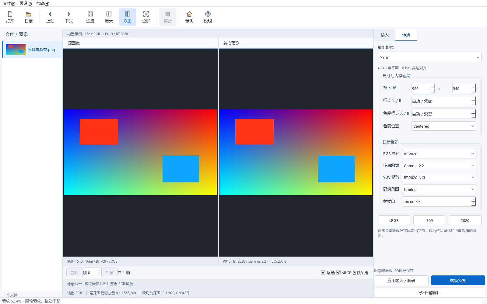

# Prism Pixel · 棱镜图像

**Prism Pixel** 是一款 Windows 图片与裸像素数据查看、转换工具，采用与 Prism Compare 一致的桌面交互风格。面向图像算法开发、视频链路调试和采集数据检查，支持常见图片容器，以及明确注册的 RGB / YUV 内存排布。

## 下载与安装

[下载 Prism Pixel 0.1.0 · Windows x64 MSI](https://github.com/changming-w/PrismPixel/releases/download/v0.1.0/PrismPixel-0.1.0-x64.msi)

Windows 10/11 x64。安装版不需要另外安装 Python。安装后可在文件上右键选择 **使用 Prism Pixel 打开**；Windows 11 中可能位于“显示更多选项”。卸载会移除该入口，不改变文件的默认打开程序。



## 软件介绍

左侧浏览文件，中间并排显示源图与转换结果，右侧通过“输入 / 转换”标签组织参数。转换预览会重新解码实际输出字节，包含量化、色度采样和压缩造成的变化；导出直接保存该结果，并附带参数 JSON。

- PNG、JPEG、BMP、TIFF、WebP 查看与转换；PNG/TIFF 支持 8bit 和 16bit 整数。
- RGB/BGR、RGBA/BGRA/ARGB/ABGR、平面 RGB/GBR、RGB565、RGB10A2、大小端、16bit 容器高位/低位对齐。
- **10bit 紧凑 RGB/BGR `.bin`**：4 分量占 5 字节、LSB 位流；每行独立打包，支持行填充。
- I420/YV12、NV12/NV21、4:2:2/4:4:4 平面和半平面、YUYV/UYVY/YVYU/VYUY、P010/P012/P016、P210/P216、Y210/Y216 等。[完整格式清单](docs/FORMATS.md)
- 独立选择 **RGB 原色、传递函数、YUV 矩阵、Full/Limited 范围**，在 BT.709、BT.2020、BT.601 525/625 原色之间进行线性光转换。
- 自定义尺寸、Y/RGB 行步长、色度行步长、文件头偏移和帧跨度；多帧文件可逐帧查看、导出。
- 适应窗口、100% 原始像素、联动缩放/平移、全屏、像素探针、参数保存和自动恢复。
- 相同采样规格及色彩定义下的 YUV 排布转换直接处理分量，避免 RGB 往返引入裁切和额外色度滤波。

## 快速开始

1. 打开图片或 `.bin/.raw/.yuv`。图片容器自动识别尺寸和整数位深；裸数据需要选择排布、宽高及必要的步长。
2. 指定源数据的色彩参数，点击 **应用输入 / 解码**。没有元数据的裸数据无法可靠推断色域或传递函数。
3. 在“转换”页选择目标排布、色彩参数和范围，点击 **转换预览**。
4. 查看实际输出预览和超范围裁切计数，点击 **导出当前帧**。输入文件不会被覆盖。

导出的 `文件名.json` 记录排布和色彩参数，放在同名数据文件旁，再次打开时自动读取。也可从“文件”菜单保存或载入输入参数。

### VSC 10bit 紧凑 BIN

“预设 → VSC · BGR10 紧凑 · 3840×2160”提供此前采集格式的快捷配置：

- 分量顺序 BGR，LSB-first 连续 10bit 位流，每行 14,400 字节。
- 有效一帧为 31,104,000 字节；默认帧跨度 49,766,400 字节，忽略每帧尾部填充。
- 如果文件没有尾部填充，将帧跨度设为 0（自动）。
- 预设色彩为 BT.2020 / Gamma 2.2 / Full，可按实际信号修改。
- **不做 VB1 重排**。该格式不是 MIPI RAW10，也不是 P010。

## 色彩转换约定

转换流程：解包 → 码值范围归一化 → Y′CbCr 解矩阵（如适用）→ 反传递函数 → D65 线性 RGB 原色变换 → 目标传递函数 → 目标矩阵与范围 → 采样、量化、打包。

- YUV 在本软件中指数字 Y′CbCr，BT.2020 矩阵采用非恒定亮度 NCL。
- BT.601 的矩阵系数与 525/625 两组 RGB 原色分开设置。
- 支持 sRGB、BT.709 OETF、BT.2020 OETF、Gamma 2.2/2.4、Linear、PQ ST2084。PQ 使用绝对亮度和参考白换算；不进行自动 tone mapping。
- 超出目标 RGB 范围的数值采用硬裁切，显示裁切分量数量；不提供感知式色域压缩。
- 居中色度使用双线性上采样、面积下采样；同位模式为左上同位。相同采样规格的纯 YUV 重排不进行采样。
- sRGB 预览只影响屏幕显示，不改变导出字节。它不是原生 HDR 输出，也不代替显示器校准。

## 支持边界

首版只支持清单内的线性内存排布，不宣称覆盖所有厂商私有格式。暂不支持 tiled/swizzled、AFBC、v210、MIPI RAW10、Bayer 去马赛克、浮点 EXR、HLG、批量视频编码及全文件多帧导出。GIF/动画和多页文档不在支持清单中，TIFF 只读首页。

图片容器按手动指定的色彩参数解释，不自动应用嵌入 ICC/EXIF 方向。导出不嵌入 ICC/CICP/HDR mastering metadata，色彩信息通过配套 JSON 保存；其他软件不会自动应用该 JSON。RGB10A2 的 Alpha 为 2bit，转为不带 Alpha 的格式会明确显示丢弃提示。

为控制内存，单帧上限 4000 万像素，单帧跨度上限 1 GiB。输入和输出分辨率保持一致；本版本不隐式缩放。

## 打开修改与构建

使用 Python 3.13 x64，双击 `setup.cmd` 建立独立环境，然后双击 `run.cmd`。VS Code 打开 `PrismPixel.code-workspace`，按 F5 调试。

```powershell
.venv/Scripts/python.exe -m unittest discover -s tests -v
.venv/Scripts/python.exe tests/ui_smoke.py
.venv/Scripts/python.exe tests/performance_4k.py
powershell -ExecutionPolicy Bypass -File scripts/build.ps1
powershell -ExecutionPolicy Bypass -File scripts/build_msi.ps1 -WixBin "C:\Tools\wix314"
```

MSI 构建需要 WiX 3.14.1。便携版需完整复制 `dist/PrismPixel/`，不能只复制 exe。源代码不包含虚拟环境、WiX、编译缓存或原始采集数据。可选独立校验：安装 FFmpeg 后运行 `tests/ffmpeg_reference.py`。

详见 [设计与架构](docs/DESIGN.md)、[第三方组件](THIRD_PARTY_NOTICES.md)。
